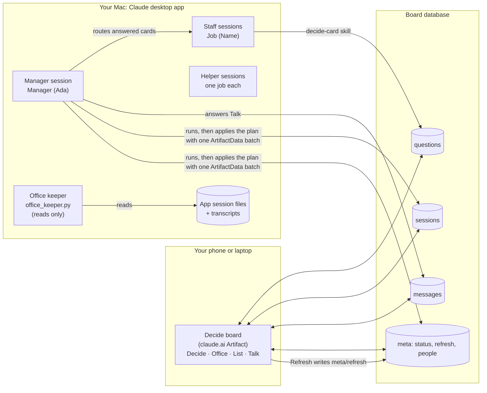

# How AI Office fits together

Four parts, and the only shared state is the board's own database on claude.ai.

## The board (`board/`)

One self-contained HTML page, published as a private claude.ai Artifact with two capabilities:

- `db`: the shared database the page and Claude Code both read and write.
- `assets`: pictures attached to cards and Talk messages.

The page has no server and loads no outside scripts. Fonts fall back to the system font.

- **Decide** lists `questions` with `status: open`, oldest first, split into "On your phone" and "At the Mac" (`where`). Tapping a button writes `answer`, `answered_at` and `status: answered` on that card. Answered cards fold into a list with a feedback box.
- **Office** draws `sessions` as an isometric town on a canvas. Each department text becomes a room (`CATS` in `core.js`). People walk to the lounge when they're on a break, quiet people stroll now and then, the manager visits rooms. A static picture of the floors and the town is drawn once into an off-screen canvas, so each frame only draws walls, furniture and people. It draws only while the tab is visible, at about 24 frames a second, and stops for reduced-motion users.
- **List** is the same `sessions` as plain cards, ordered by status.
- **Talk** is `messages` between `owner` and `manager`.

`board/src/page.html` is the Decide/List/Talk page with three slots. `tools/build_board.py` fills them with the Office CSS (scoped under `.ow`), HTML (ids prefixed `ow-`) and script (`theme.js` with `chunk3d.js` inlined, then `core.js`). It also writes `demo.html` with a tiny in-memory database.

## The keeper (`src/ai_office/keeper.py`)

Reads the desktop app's session records (`local_*.json`) and the tail of each transcript. It keeps sessions titled `Job (Name)`, works out a status (see SETUP), and takes the first sentence of the last reply as the "latest" line.

It never writes to the board. A board write needs a live approval, and a background process can only ask for it and then stop. So:

1. `--plan` saves a plan and exits 3 if anything changed since the last verified apply.
2. `--batch -` takes the pasted ArtifactData listing (to learn each document's version) and prints the writes, split into batches of at most 50 with `meta/status` last: `set` per person (pinned to its version), `delete` for people who left, and an `update` of `meta/status`.
3. The manager runs the batches in order.
4. `--confirm -` reads back `meta/status.filled_at`. Only an exact match counts as VERIFIED, and only then does `--plan` treat the board as up to date.

Every write is pinned with `if_version`, so a concurrent change fails cleanly instead of being overwritten.

## The rules and skills (`claude/`)

- `CLAUDE.md` makes every session follow the same conventions: staff vs helper naming, who talks to whom, short cards, and "an answer on a card is a yes for that exact action, read from the source".
- `decide-card` is how any session asks the owner something.
- `manager-checkin` is the manager's loop: route answered cards, answer Talk, nudge staff, archive finished helpers, update the Office.

## Data shapes

| Collection / doc | Fields |
|---|---|
| `questions/<id>` | `title`, `context`, `options[]`, `rec`, `rec_index`, `why`, `session`, `when`, `where`, `status` (open, answered, done), `created`, `links[]`, `image`, `answer`, `answer_images[]`, `answered_at`, `reply` |
| `sessions/<id>` | `session`, `name`, `dept`, `status` (BUILDING, DONE, IDLE, NEEDS YOU, BLOCKED, PARKED), `latest`, `ts`, `order`, optional `district` to force a room |
| `messages/<auto>` | `from` (owner or manager), `text`, `images[]`, `at`, `seen`, optional `ref` and `about` |
| `meta/status` | `line`, `filled_at` |
| `meta/refresh` | `requested_at` |
| `meta/people` | `owner`, `manager` (each `{name, pic?, emoji?}`), `staff` (`{title prefix: {name, pic?}}`) |
