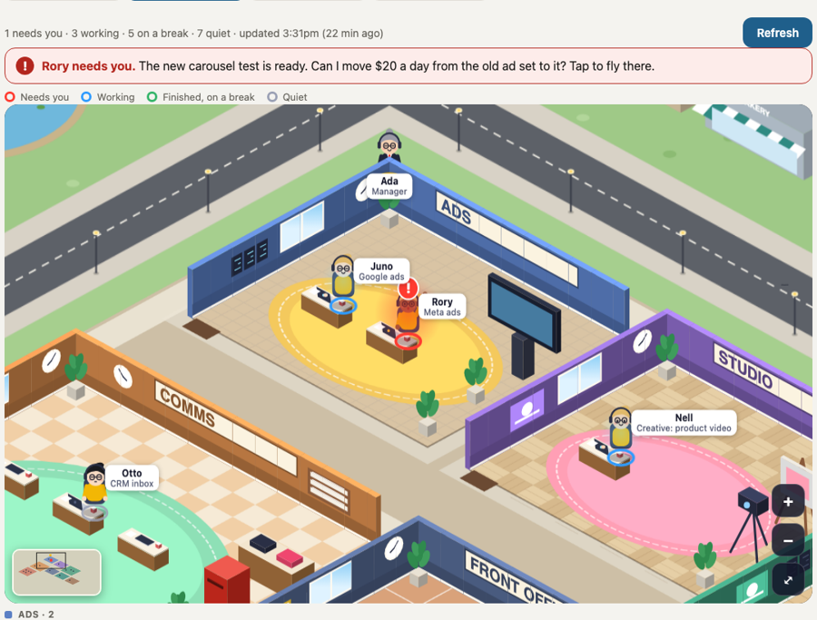
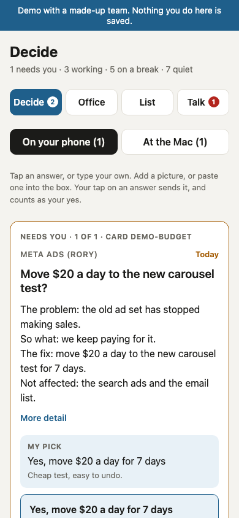

# AI Office

**Run a team of Claude Code sessions like a small company, and make every decision from your phone.**

By [Matthew R Scott](https://matthewrscott.com).

Once you have more than a handful of Claude Code sessions going, the hard part isn't the code. It's knowing who is doing what, who is stuck, and which of them is waiting on you. AI Office gives you three things to fix that:

1. **A Decide board.** One private page on claude.ai with four tabs:
   - **Decide**: cards from your sessions, each asking you one thing. Tap an answer on your phone and your tap is the go-ahead.
   - **Office**: a little isometric town with a room per department. Every staff session sits at a desk, and you can see who is working, who is on a break and who needs you (red). Pan, zoom, tap anyone.
   - **List**: the same people as a plain list.
   - **Talk**: a chat with your manager session.
2. **A manager.** One session (we call ours Ada) runs a check-in every few hours. It hands your answers to the right session, answers your Talk messages, nudges anyone stuck, tidies up finished helpers (with your OK) and keeps the Office up to date.
3. **House rules.** A short block for your `CLAUDE.md` that makes every session behave the same way: staff sessions are named `Job (Name)`, one-off helpers aren't, everything that needs you arrives as a short card, and your answer on a card is your yes for that one action.

**See it first:** double-click `board/demo.html` to open it in your browser and click around a made-up team. The demo saves nothing; your own board comes in setup step 2.

| The Office on a laptop | A Decide card on a phone |
|---|---|
|  |  |

## Quick start

**The easy way:** unzip the kit into your home folder, open it in Claude Code (the Code tab in the Claude desktop app), and paste:

> Read INSTALL_WITH_CLAUDE.md and set up AI Office for me.

Claude does the rest, asks before changing anything outside the folder, and tells you when to click Allow. Your board starts with one welcome card to try. The Office fills in after the manager's first check-in. Full steps, by hand, are in [SETUP.md](SETUP.md). The short version:

1. Open `board/demo.html` to see it.
2. In Claude Code, publish `board/decide-board.html` as an Artifact with the `db` and `assets` capabilities. That's your board.
3. Paste `claude/CLAUDE.md` into your own `CLAUDE.md` and fill in your board link and your name.
4. Copy `claude/skills/*` into `~/.claude/skills/`.
5. Rename your long-running sessions `Job (Name)`.
6. Start one session titled `Manager (Ada)` and run `/manager-checkin` once by hand. When that works, put it on a timer: `/loop 3h /manager-checkin`.
7. Use it: answer cards on your phone, watch the Office, talk to the manager.

Check the kit itself at any time:

```bash
python3 tests/smoke_test.py
```

## What it will never do

- It never answers a card for you, and a session never acts on a "yes" it heard from another session. It reads your answer on the card itself.
- The kit's own parts (the board, the manager, the keeper) never move money, send an email or message to anyone outside, post anything, or delete your files. The only things they write are your board's own cards and Office rows (removing a row when someone leaves the Office), the keeper's small state folder `~/.ai-office`, and messages from the manager to your own sessions.
- A card answer is a yes only for the exact action that card names, read by the session from the card itself. If a card asks to send something, your tap is what allows it, so read before you tap. Moving money is never done from a card: that stays with you.
- It never runs when your Mac is asleep or the Claude app is closed. Nothing runs on a server.
- The manager only routes, reminds and tidies: it passes answered cards to the session that owns them, answers your Talk messages, nudges stuck sessions and updates the Office. It archives finished one-job helpers only if you switch that on (archived sessions can be brought back from the sidebar).
- Setup asks before it changes anything outside the kit folder (your Claude rules file and skills folder).

## Privacy

- Your board is a private claude.ai page. Only people you share the link with can open it, and anyone you share it with can answer your cards.
- The Office keeper runs on your Mac and reads your session titles and the last reply of each staff session. It puts the title, a one-line summary and a status on your board. Nothing goes anywhere else.

## What it costs and what keeps running

- **The kit is free.** It needs a claude.ai plan that lets Claude Code publish Artifacts.
- **The manager uses your Claude usage.** Each check-in is a short turn in one session. Setup starts it every 3 hours (`/loop 3h /manager-checkin`), and only after one check-in by hand has worked. Make it hourly if you want, or run it by hand when you want an update.
- **One session stays open:** the manager. Its conversation grows, so start a fresh manager session every week or so (same title).
- **To stop it:** stop the loop in the manager session (or just close that session). Everything else carries on as normal Claude Code.

## Who it's for

- You use **Claude Code in the Claude desktop app on a Mac**, with several sessions running at once.
- You're not a full-time developer, or you are and you'd rather approve things from your phone than babysit terminals.
- You have a claude.ai account that can publish Artifacts from Claude Code.

## What it does

- Puts every decision your sessions need from you in one place, as short cards you can answer on a phone.
- Makes "yes" safe: a session only acts on your answer if it reads the card itself and the answer names the exact action.
- Shows your whole team at a glance, with the person who needs you in red at the top.
- Keeps a manager session doing the routing and tidying, so you only talk to the session that owns the work.

## What it doesn't do

- It doesn't start new sessions by itself, only when you ask the manager in Talk. The manager uses Claude Code's own session tools, with your permissions.
- It doesn't work outside the Claude desktop app on a Mac. The Office keeper reads the app's own session files (see [HANDOFF_NOTES](HANDOFF_NOTES.md)).
- It doesn't need a server, a database or an API key. The board is a claude.ai Artifact with its built-in database.
- It doesn't send anything to anyone. Nothing in the kit emails, posts or pays.

## What's in the box

| Path | What it is |
|---|---|
| `board/decide-board.html` | The page you publish as your board |
| `board/demo.html` | The same page with a fake database and a made-up team |
| `board/src/` | The source the board is built from (only if you want to change it) |
| `tools/build_board.py` | Rebuilds the two board pages from `board/src/` |
| `claude/CLAUDE.md` | The house rules to paste into your `CLAUDE.md` |
| `claude/skills/manager-checkin/` | The manager's check-in |
| `claude/skills/decide-card/` | How any session posts a card |
| `INSTALL_WITH_CLAUDE.md` | Setup steps written for Claude to follow for you |
| `install.sh` | Copies the skills and house rules into your Claude folder |
| `office_keeper.py` | Runs the Office keeper from any folder |
| `docs/` | The pictures in this README |
| `src/ai_office/` | The Office keeper (Python, standard library only) |
| `people.example.json` | Optional overrides for order and department |
| `tests/smoke_test.py` | Checks everything without a network or an account |

More: [ARCHITECTURE.md](ARCHITECTURE.md) for how the pieces fit, [ROADMAP.md](ROADMAP.md) for what's next, [HANDOFF_NOTES.md](HANDOFF_NOTES.md) for what's tested and what isn't.

## Licence

MIT. See [LICENSE](LICENSE). Made by Matthew R Scott. More tools and the thinking behind them at [matthewrscott.com](https://matthewrscott.com).
